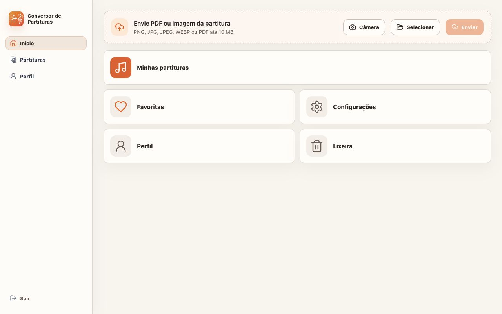
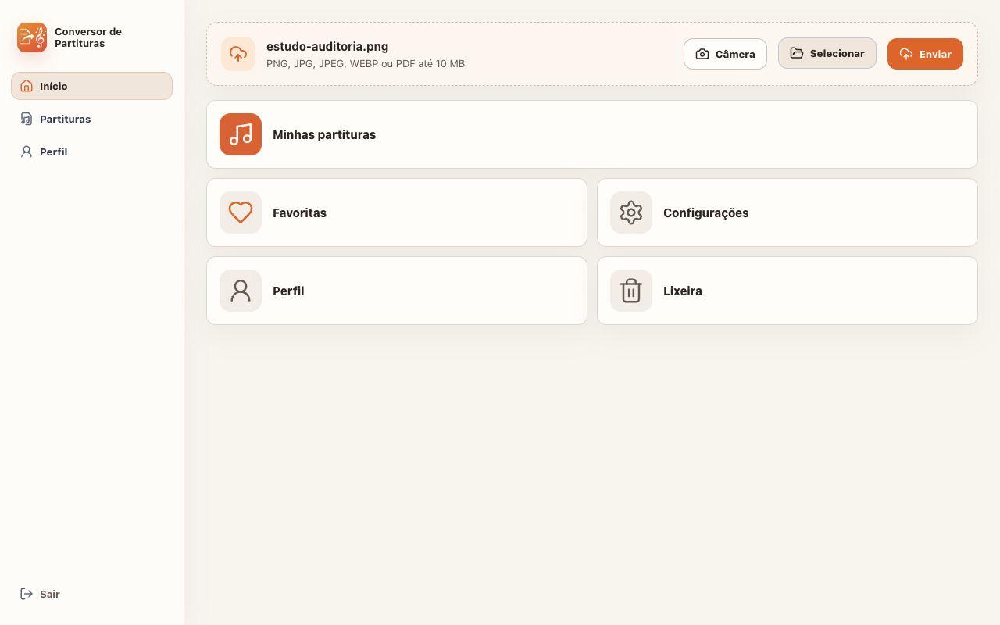
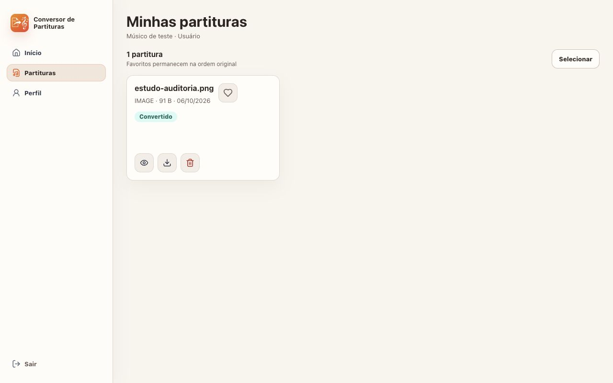
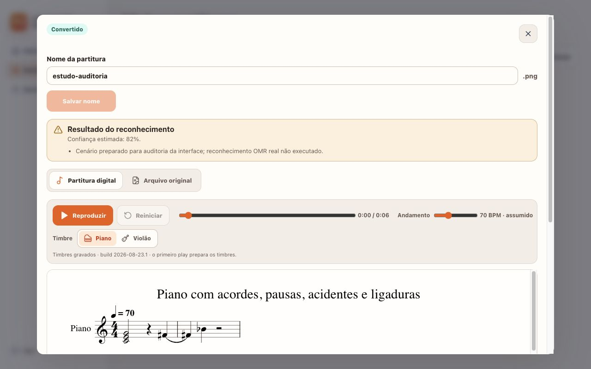
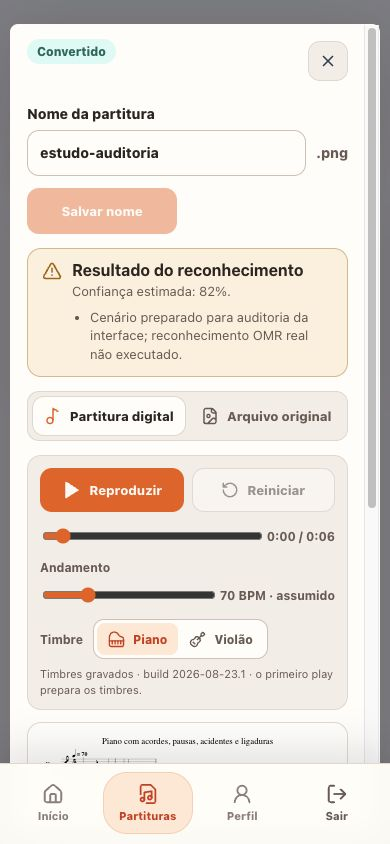

# Auditoria do Conversor de Partituras

Auditoria de 6 de outubro de 2026 do checkout local: web, API, conversão, aplicativo móvel e documentação de lançamento. O produto tem uma identidade visual coerente e uma base técnica com testes. A prioridade é garantir que o resultado musical preserve o documento e que o usuário compreenda o estado da conversão. A preparação das lojas ainda exige verificações externas e em aparelhos.

O [roadmap central](../../PROJECT_ROADMAP.md) organiza a execução. Esta auditoria registra problemas e critérios; não aplica correções de comportamento.

## Veredito sobre a implementação

**A identidade do produto passa; a prontidão de lançamento exige correções.** Marca, cores quentes, foco em partituras e componentes de reprodução formam um sistema reconhecível. Há falhas concretas no isolamento do diálogo, no contraste e no retorno após envio. A API pode liberar resultados com páginas ausentes, e a porcentagem apresentada como confiança não é uma medida calibrada de precisão musical.

O detector Impeccable retornou somente um aviso sobre `Inter` em `global.css:3`. Ele não justifica uma troca de fonte: o produto usa uma pilha de fontes do sistema, e Inter é uma preferência na pilha, sem uma fonte web carregada encontrada. Este aviso não foi contado como defeito. Os problemas abaixo foram verificados por captura, medição ou leitura do código.

## Resumo e prioridades

Foram registrados **27 achados: 0 P0, 18 P1, 9 P2 e 0 P3**. P1 inclui problemas confirmados no código e riscos de lançamento cuja condição está descrita. A ausência de P0 reproduzido nesta sessão não comprova que a conversão real ou a produção estejam prontas.

As prioridades são cobertura musical explícita, retentativas recuperáveis, atualização do estado na interface, contraste e isolamento do diálogo. Depois vêm configuração de produção, compras, artefatos móveis e homologação física.

| Dimensão da web auditada | Nota | Evidência principal |
| --- | --- | --- |
| Acessibilidade | 1/4 | Contraste de aproximadamente 2,97:1 nos botões principais; foco sai do diálogo. |
| Desempenho | 2/4 | Verovio já é carregado sob demanda, mas seu módulo tem 7,85 MB minificados; falta medir a primeira abertura em rede móvel. |
| Responsividade | 2/4 | Início e controles refluem a 390 px; navegação inferior sobrepõe o diálogo. |
| Tema e tokens | 3/4 | Tema claro intencional e tokens amplamente usados; valores avulsos e divergências móveis requerem atenção. |
| Integridade da implementação | 2/4 | Sistema visual coerente, com lacunas no contrato de conversão e na atualização de estados. |
| **Total** | **10/20** | **Aceitável como base; trabalho significativo antes do lançamento.** |

A nota é uma orientação do Impeccable para o frontend inspecionado. Não é certificação WCAG, nota de precisão OMR nem pontuação de um aplicativo nativo executado em aparelho.

## Escopo e evidências

A captura usou o navegador interno do Codex, com imagens desktop de 1280 × 800 e imagens estreitas de 390 × 844; a captura 8 tem 375 × 812. A API da sessão usou repositórios em memória, usuário descartável, armazenamento temporário e um adaptador preparado que devolve uma fixture MusicXML existente. O upload e a interface usam os serviços reais do projeto; **o reconhecimento Audiveris não foi executado**. A porcentagem de 82% vista nas capturas é um valor do cenário preparado, não uma medição de precisão.

O arquivo original de teste é uma imagem mínima; sua aba foi alternada para conferir o comportamento, mas não permite avaliar a legibilidade de uma foto ou PDF real. Não foram usados screenshots antigos como evidência desta auditoria.

| Verificação | Resultado em 2026-10-06 | Limite |
| --- | --- | --- |
| API | 45 testes passaram; lint e build passaram. | Repositórios em memória; sem OMR real, PostgreSQL/Redis reais ou deploy. |
| Web | 86 testes passaram; lint e build passaram. | Testes existentes não cobrem todos os problemas observados no navegador. |
| Mobile | 40 testes passaram; lint/typecheck passou. | Typecheck não gera nem valida IPA/AAB de release. |
| Total automatizado | **171 testes passaram.** | Não comprova fidelidade musical ou áudio em aparelhos. |
| Prisma | Schema validado com URL fictícia. | Sem migração aplicada a banco. |
| Detector Impeccable | Um aviso de fonte, contextualizado acima. | Sem scanner completo de acessibilidade ou análise de dependências. |
| Navegador | Envio, biblioteca, renderização, troca de aba, teclado e dois tamanhos de tela. | Sem toque sintetizado, dispositivo físico, zoom de 200%, VoiceOver ou TalkBack. |

O build web emitiu aviso de tamanho do módulo Verovio e de externalização de `node:module`. O build concluiu e o player renderizou; não foi tratado como falha de compilação.

## Fluxo capturado

### 1 Entrada

**Saúde: funcional, com contraste a corrigir.** Campos têm rótulos e a ação principal está clara. O texto claro do botão não alcança 4,5:1; os campos também não informam autocomplete. A recuperação de senha não foi avaliada como requisito desta auditoria.

### 2 Início

**Saúde: boa descoberta da ação principal.** Envio aparece primeiro e os formatos são explicados. O início não mostra conversões recentes ou andamento de tarefas já enviadas. Os cinco atalhos grandes consomem mais espaço que a informação sobre o trabalho em curso.

### 3 Arquivo selecionado

**Saúde: funcional.** Nome do arquivo aparece e Enviar fica disponível. A sessão confirmou seleção de arquivo pelo seletor. Câmera real, permissões e arquivos próximos do limite não foram exercitados no navegador.

### 4 Após o envio

**Saúde: precisa de correção.** O nome some e o botão volta a ficar desabilitado, sem confirmação de envio, status ou abertura do item. O usuário precisa descobrir que deve entrar em Minhas partituras. O adaptador preparado estava processando o envio nesse momento.

### 5 Biblioteca

**Saúde: funcional, com lacunas no acompanhamento.** O item mudou de Processando para Convertido na lista. Favorito, detalhes e download têm nomes acessíveis. Abrir um item durante processamento expõe a falha de atualização do diálogo descrita em F08; ela foi confirmada no código, não reproduzida nesta captura de item já convertido.

### 6 Resultado digital no desktop

**Saúde: partitura renderizada, diálogo precisa de correção.** Alternância entre original e digital, andamento assumido, timbres e formatos de download são descobertos. Shift+Tab a partir de Fechar levou o foco ao botão Excluir da biblioteca atrás do diálogo. A captura também mostra uma porcentagem sem vínculo com precisão real e a identificação interna do build de timbres.

### 7 Resultado digital em tela estreita

**Saúde: reflow funciona; sobreposição importante.** Não foi medido overflow horizontal da página nesse estado. Controles se empilham, mas a barra inferior aparece sobre o diálogo e cobre parte da área útil. Fechar e abas têm 40 px de altura; timbres têm 32 px. A partitura e os downloads exigem rolagem interna. A captura é de viewport emulado, não de aparelho nem de toque real.

### 8 Início em tela estreita

**Saúde: funcional, com custo de rolagem.** Envio se reorganiza e os botões são amplos. A lixeira fica abaixo da primeira área visível porque todos os atalhos são grandes. Rótulos inativos da barra usam uma cor com contraste inferior a 4,5:1. Esse estado não valida a navegação de administrador, que tem mais destinos.

### 9 Configurações

**Saúde: incompleta.** A tela anuncia preferências futuras e traz informações estáticas. Rótulos e valores aparecem colados, como Conversão automáticaAtiva. Suporte não oferece uma forma de contato. Não convém promover esta tela como um destino de configuração funcional.

## Achados P1

### F01 Resultado parcial é liberado como completo

**Categoria:** integridade da conversão. **Fonte:** [OmrAdapter.ts:86](/Users/reifison/Desktop/Apps/score-to-musicxml/apps/api/src/services/OmrAdapter.ts:86), [ScoreConversionService.ts:49](/Users/reifison/Desktop/Apps/score-to-musicxml/apps/api/src/services/ScoreConversionService.ts:49) e [ScoreService.ts:145](/Users/reifison/Desktop/Apps/score-to-musicxml/apps/api/src/services/ScoreService.ts:145).

Uma página que falha é omitida; se houver páginas reconhecidas, o resultado recebe `converted`. Player e MIDI não recebem uma cobertura estruturada para bloquear lacunas. O músico pode ouvir trechos sobreviventes unidos como se o documento estivesse completo. Implementar cobertura por página/pauta/parte e a política já registrada em CONVERSION_RELIABILITY.md: parcial somente por páginas inteiras ausentes, com MusicXML avisado e player/MIDI bloqueados; perda de pauta/parte obrigatória falha a tentativa. **Comando de interface:** `$impeccable harden` após o contrato existir na API.

### F02 Confiança fixa aparece como porcentagem de qualidade

**Categoria:** integridade e clareza. **Fonte:** [OmrAdapter.ts:262](/Users/reifison/Desktop/Apps/score-to-musicxml/apps/api/src/services/OmrAdapter.ts:262), [ScoreConversionService.ts:12](/Users/reifison/Desktop/Apps/score-to-musicxml/apps/api/src/services/ScoreConversionService.ts:12), [ScoreDetails.tsx:25](/Users/reifison/Desktop/Apps/score-to-musicxml/apps/web/src/components/ScoreDetails.tsx:25). **Tela:** 6 e 7.

O caminho normal retorna 0,75; o serviço aceita valores a partir de 0,70. Isso não mede altura, ritmo ou vozes. Remover a porcentagem e mostrar fatos de cobertura, falhas e orientação de revisão; não substituir por uma promessa de precisão sem avaliação musical. **Comando:** `$impeccable clarify`.

### F03 Associação entre páginas pode perder partes

**Categoria:** integridade da conversão. **Fonte:** [OmrAdapter.ts:613](/Users/reifison/Desktop/Apps/score-to-musicxml/apps/api/src/services/OmrAdapter.ts:613).

A junção percorre os IDs da primeira página e procura esses mesmos IDs nas demais. Uma parte que aparece depois ou recebe outro identificador pode desaparecer. Mapear identidades musicais estáveis, validar pautas/vozes esperadas e testar duo, piano e IDs diferentes. **Comando de interface:** `$impeccable harden` para comunicar as falhas detectadas pelo backend.

### F04 Erros tratados não acionam a retentativa da fila

**Categoria:** recuperação operacional. **Fonte:** [ScoreConversionQueue.ts:29](/Users/reifison/Desktop/Apps/score-to-musicxml/apps/api/src/queues/ScoreConversionQueue.ts:29) e [ScoreConversionService.ts:65](/Users/reifison/Desktop/Apps/score-to-musicxml/apps/api/src/services/ScoreConversionService.ts:65).

A fila permite duas tentativas, mas o serviço captura erros OMR e retorna um score `failed` normalmente. A fila entende que o job terminou. Separar falhas temporárias/permanentes, propagar as temporárias, oferecer a retentativa manual definida no contrato e preservar o resultado anterior sem cobrar outro scan pelo mesmo envio. **Comando de interface:** `$impeccable harden`.

### F05 Envio pode ficar sem job após falha na fila

**Categoria:** consistência operacional. **Fonte:** [ScoreUploadService.ts:29](/Users/reifison/Desktop/Apps/score-to-musicxml/apps/api/src/services/ScoreUploadService.ts:29).

Arquivo, score e débito de quota podem ser persistidos antes de `enqueue`; falha posterior não desfaz nem reconcilia esse estado. O usuário pode receber erro e deixar uma tarefa eternamente em fila. Implementar outbox ou reconciliação idempotente, com recuperação comprovada quando Redis/auditoria/enfileiramento falhar. **Comando de interface:** `$impeccable harden`.

### F06 Domínio dedicado da API não tem bloco de proxy

**Categoria:** risco de configuração de lançamento. **Fonte:** [Caddyfile:1](/Users/reifison/Desktop/Apps/score-to-musicxml/Caddyfile:1), [.env.production.example:2](/Users/reifison/Desktop/Apps/score-to-musicxml/.env.production.example:2), [deploy-prod.sh:40](/Users/reifison/Desktop/Apps/score-to-musicxml/scripts/deploy-prod.sh:40).

O template usa hosts diferentes para web e API, e o deploy exige essa correspondência. Caddy declara apenas WEB_DOMAIN. Se os clientes usam o host dedicado, ele não é servido por essa configuração. O problema não se aplica quando ambos os hosts são iguais; DNS e implantação real não foram consultados. Eleger topologia consistente e validar os dois hosts por HTTPS. **Verificação de interface:** `$impeccable audit` depois da verificação operacional.

### F07 Falta confirmação e acompanhamento após envio

**Categoria:** fluxo e comunicação de estado. **Fonte:** [App.tsx:85](/Users/reifison/Desktop/Apps/score-to-musicxml/apps/web/src/pages/App.tsx:85), [UploadPanel.tsx:12](/Users/reifison/Desktop/Apps/score-to-musicxml/apps/web/src/components/UploadPanel.tsx:12). **Telas:** 3 e 4.

O retorno do envio é descartado, o seletor é limpo e o início não mostra o item. Abrir o resultado enviado ou inserir status junto ao upload, com confirmação anunciada por tecnologia assistiva. Separar Enviando, Na fila, Processando, Parcial, Concluído e Falhou, conforme o modelo final. **Comandos:** `$impeccable onboard`, `$impeccable clarify`.

### F08 Diálogo não acompanha o polling da lista

**Categoria:** integridade do estado. **Fonte:** [App.tsx:27](/Users/reifison/Desktop/Apps/score-to-musicxml/apps/web/src/pages/App.tsx:27), [App.tsx:56](/Users/reifison/Desktop/Apps/score-to-musicxml/apps/web/src/pages/App.tsx:56) e [ScoreDetails.tsx:29](/Users/reifison/Desktop/Apps/score-to-musicxml/apps/web/src/components/ScoreDetails.tsx:29).

O intervalo instalado após login captura `selected` nulo; abrir detalhes não reinstala esse intervalo. A biblioteca atualiza, mas o score do diálogo fica obsoleto. Além disso, a aba inicial é decidida apenas no primeiro render. Derivar o item selecionado pelo ID a partir da coleção atual e atualizar a visualização quando a conversão terminar. Aceite: abrir um item queued, avançar o polling e ver status, abas e downloads atualizados sem fechar. **Comando:** `$impeccable harden`. Constatação por código, confirmada por revisão independente; a captura 5 mostra um item já convertido.

### F09 Falhas de atualização e sessão não recebem tratamento

**Categoria:** recuperação e confiança. **Fonte:** [App.tsx:49](/Users/reifison/Desktop/Apps/score-to-musicxml/apps/web/src/pages/App.tsx:49), [App.tsx:58](/Users/reifison/Desktop/Apps/score-to-musicxml/apps/web/src/pages/App.tsx:58), [client.ts:46](/Users/reifison/Desktop/Apps/score-to-musicxml/apps/web/src/api/client.ts:46).

Polling e carregamento administrativo descartam promises sem capturar rejeição. A verificação inicial de sessão transforma qualquer erro em tela de login. Falha de rede pode parecer logout ou lista vazia/antiga. Tratar rede, 401 e erro servidor separadamente, com estado de carregamento, informação de atualização e recuperação; limitar polling a conversões ativas e suspender quando apropriado. **Comando:** `$impeccable harden`.

### F10 Texto de botões e navegação tem contraste insuficiente

**Categoria:** acessibilidade e tokens. **Fonte:** [global.css:19](/Users/reifison/Desktop/Apps/score-to-musicxml/apps/web/src/styles/global.css:19), [global.css:203](/Users/reifison/Desktop/Apps/score-to-musicxml/apps/web/src/styles/global.css:203), [global.css:1778](/Users/reifison/Desktop/Apps/score-to-musicxml/apps/web/src/styles/global.css:1778). **Telas:** 1, 3, 6 e 8. **Referência:** WCAG 1.4.3, contraste mínimo para texto normal.

Os pares OKLCH computados resultam em aproximadamente 2,97:1 para texto claro sobre brand e 3,34:1 para faint sobre surface. Brand-2 com o mesmo texto chega a cerca de 4,33:1, ainda abaixo de 4,5:1. Manter a identidade laranja escolhendo tokens de ação e texto que alcancem a meta; validar também estados ativo, hover, erro e mobile. Controles desabilitados não foram usados para caracterizar essa violação. **Comando:** `$impeccable colorize`.

### F11 Diálogo não isola foco nem fica acima da navegação móvel

**Categoria:** acessibilidade e responsividade. **Fonte:** [ScoreDetails.tsx:34](/Users/reifison/Desktop/Apps/score-to-musicxml/apps/web/src/components/ScoreDetails.tsx:34), [global.css:801](/Users/reifison/Desktop/Apps/score-to-musicxml/apps/web/src/styles/global.css:801), [global.css:1742](/Users/reifison/Desktop/Apps/score-to-musicxml/apps/web/src/styles/global.css:1742). **Telas:** 6 e 7. **Referências:** ordem de foco, foco não obscurecido e comportamento de diálogo modal; conferir WCAG 2.4.3/2.4.11 na correção.

O diálogo declara aria-modal, mas o conteúdo de fundo continua navegável. Shift+Tab desde Fechar focou Excluir atrás dele. A barra móvel tem z-index 30 e o backdrop 20, ficando visualmente por cima. Isolar o fundo com inert/solução de diálogo apropriada, conter e restaurar foco, colocar o modal acima de todas as barras e impedir navegação de fundo. **Comandos:** `$impeccable harden`, `$impeccable adapt`.

### F12 Formulários administrativos não têm rótulos persistentes

**Categoria:** acessibilidade. **Fonte:** [App.tsx:573](/Users/reifison/Desktop/Apps/score-to-musicxml/apps/web/src/pages/App.tsx:573). **Referências:** WCAG 1.3.1 e 3.3.2.

Nome, e-mail e senha inicial dependem de placeholders; seleção de perfil e seletores por usuário não têm associação explícita a um rótulo. Adicionar labels persistentes, associar ajudas e erros e identificar o usuário nos controles da tabela. Este fluxo foi inspecionado no código, sem captura de administrador nesta sessão. **Comando:** `$impeccable harden`.

### F13 Compra pode apresentar preço que não veio da loja

**Categoria:** integridade de compra mobile. **Fonte:** [scores.tsx:153](/Users/reifison/Desktop/Apps/score-to-musicxml/apps/mobile/app/scores.tsx:153) e [scores.tsx:435](/Users/reifison/Desktop/Apps/score-to-musicxml/apps/mobile/app/scores.tsx:435).

O fallback é R$ 29,90; o botão fica habilitado enquanto o produto não foi carregado, salvo durante a mutation. Esse valor pode divergir do preço localizado da loja. Exibir preço somente do produto retornado, distinguir carregamento/indisponibilidade e bloquear a ação até estar pronto. Validar falha da loja, compra e restauração em sandbox nas duas plataformas. **Comando:** `$impeccable harden` com o playbook nativo.

### F14 Player offline não corresponde ao caminho mobile

**Categoria:** integridade de plataforma. **Fonte:** [ScorePlayerWebView.tsx:225](/Users/reifison/Desktop/Apps/score-to-musicxml/apps/mobile/src/player/ScorePlayerWebView.tsx:225), [config.ts:23](/Users/reifison/Desktop/Apps/score-to-musicxml/apps/mobile/src/player/config.ts:23), [ANDROID_RELEASE_RUNBOOK.md:31](/Users/reifison/Desktop/Apps/score-to-musicxml/docs/ANDROID_RELEASE_RUNBOOK.md:31).

O player abre URL remota HTTPS, com cache WebView desabilitado; os assets Android copiados pelo plugin não têm consumidor local encontrado no RN. Cache do MusicXML sozinho não garante abertura offline. Integrar origem local segura, caso offline seja requisito, ou corrigir a expectativa documentada; comprovar a opção escolhida em aparelho sem rede. **Comando:** `$impeccable harden` nativo.

### F15 Versão e build não têm uma fonte consistente

**Categoria:** risco de lançamento mobile. **Fonte:** [app.json:6](/Users/reifison/Desktop/Apps/score-to-musicxml/apps/mobile/app.json:6), [project.pbxproj:344](/Users/reifison/Desktop/Apps/score-to-musicxml/apps/mobile/ios/ScoretoMusicXML.xcodeproj/project.pbxproj:344), [eas.json:16](/Users/reifison/Desktop/Apps/score-to-musicxml/apps/mobile/eas.json:16), [registro Apple:64](/Users/reifison/Desktop/Apps/score-to-musicxml/docs/APP_STORE_REVIEW_RESPONSE_2026-09-08.md:64).

Expo/Info.plist registram 0.1.0/build 1; Xcode registra versão 1.0/build 1, e o histórico local de submissão diz 1.0 (6). EAS incrementa versionCode Android. Definir a fonte de versão e incremento de cada plataforma; conferir os valores extraídos de IPA/AAB final e o próximo número disponível nas lojas. O estado atual da Apple não foi consultado. **Verificação de interface:** `$impeccable audit` nativo no artefato candidato.

### F16 Gradle release aponta para assinatura de debug

**Categoria:** risco de lançamento Android. **Fonte:** [build.gradle:112](/Users/reifison/Desktop/Apps/score-to-musicxml/apps/mobile/android/app/build.gradle:112).

A configuração local usa signingConfigs.debug em release. EAS pode aplicar credenciais no processo, mas nenhum artefato final foi inspecionado nesta auditoria. Configurar/documentar a assinatura de produção e verificar o certificado do AAB final. Não tratar a assinatura incorreta como fato de um AAB que não foi gerado. **Verificação de interface:** `$impeccable audit` nativo depois do preflight de release.

### F17 Precisão do OMR real ainda não foi comprovada

**Categoria:** lacuna de validação de lançamento. **Fonte:** [CONVERSION_RELIABILITY_ROADMAP.md:46](/Users/reifison/Desktop/Apps/score-to-musicxml/docs/CONVERSION_RELIABILITY_ROADMAP.md:46).

Testes de fixtures e uma interface que abre MusicXML não medem Audiveris frente ao original. O contrato registra corpus de 20 referências/40 entradas e meta de no máximo 2% de eventos incorretos por arquivo e parte, ainda pendentes. Executar a linha de base e a avaliação após correções, preservando reprovações individuais; a média não substitui aprovação de cada caso. **Comando de interface:** `$impeccable clarify` para manter as limitações visíveis; a validação musical é trabalho próprio.

### F18 Heurística bloqueia exercícios curtos e ignora PDFs

**Categoria:** integridade da conversão. **Fonte:** [OmrAdapter.ts:674](/Users/reifison/Desktop/Apps/score-to-musicxml/apps/api/src/services/OmrAdapter.ts:674).

A validação mínima só se aplica a imagens e exige quatro compassos/oito notas. Um exercício curto legítimo pode ser rejeitado, enquanto PDF não passa por essa barreira. Aplicar verificações estruturais equivalentes, baseadas no tipo de partitura e em cobertura, aceitando exemplos curtos válidos e rejeitando saídas realmente vazias/incompletas. **Comando de interface:** `$impeccable harden`.

## Achados P2

### F19 Timeout não cancela o trabalho e faltam limites de páginas

**Categoria:** operação e desempenho. **Fonte:** [ScoreConversionService.ts:79](/Users/reifison/Desktop/Apps/score-to-musicxml/apps/api/src/services/ScoreConversionService.ts:79), [OmrAdapter.ts:267](/Users/reifison/Desktop/Apps/score-to-musicxml/apps/api/src/services/OmrAdapter.ts:267).

Promise.race rejeita sem cancelar o processamento; a limpeza temporária pode começar com subprocessos ainda ativos. O timeout individual do Audiveris limita sua duração, mas não equivale a cancelamento global. Adotar cancelamento propagado e limites de páginas/recursos, com teste de processo encerrado e limpeza segura. **Comando de interface:** `$impeccable harden` para comunicar limite e recuperação.

### F20 Health não mede prontidão do fluxo

**Categoria:** operação. **Fonte:** [app.ts:29](/Users/reifison/Desktop/Apps/score-to-musicxml/apps/api/src/app.ts:29), [deploy-prod.sh:66](/Users/reifison/Desktop/Apps/score-to-musicxml/scripts/deploy-prod.sh:66).

Health responde ok sem verificar banco, Redis ou worker, mas o deploy usa essa resposta como gate. Separar liveness de readiness e verificar uma conversão controlada após implantação, além de métricas de fila/idade dos jobs. **Verificação de interface:** `$impeccable audit` somente após a API estar operacional.

### F21 Primeira abertura do player precisa de orçamento de desempenho

**Categoria:** desempenho. **Fonte:** [ScorePlayer.tsx:213](/Users/reifison/Desktop/Apps/score-to-musicxml/apps/web/src/components/ScorePlayer.tsx:213), [verovioLoader.ts:1](/Users/reifison/Desktop/Apps/score-to-musicxml/apps/web/src/score/verovioLoader.ts:1) e build local.

O módulo Verovio tem 7.852,22 kB minificados e 2.333,39 kB gzip. Ele **já é importado sob demanda**; não atribuir esse peso ao login. Medir a primeira renderização em rede móvel e aparelho alvo, conferir cache/compactação e decidir otimização adicional pelos resultados. A sessão local renderizou a fixture; não houve medição de rede limitada ou Core Web Vitals. **Comando:** `$impeccable optimize`.

### F22 Alguns alvos ficam abaixo do padrão de toque do projeto

**Categoria:** responsividade e acessibilidade. **Fonte:** [global.css:203](/Users/reifison/Desktop/Apps/score-to-musicxml/apps/web/src/styles/global.css:203), [PlaybackControls.tsx:88](/Users/reifison/Desktop/Apps/score-to-musicxml/apps/web/src/components/PlaybackControls.tsx:88). **Tela:** 7.

Foram medidos 40 px para Fechar/abas e 32 px para timbres; a base desktop de botões tem 40 px, enquanto DESIGN.md prevê 48 px para primários web e 44 px para toque. Aumentar alvos efetivos sem inflar toda a composição. A meta de 44 px é a do projeto; não foi alegada violação automática do mínimo WCAG 2.2 AA de 24 px. **Comando:** `$impeccable adapt`.

### F23 Navegação mobile de admin tem destinos demais

**Categoria:** adaptação nativa. **Fonte:** [BottomNav.tsx:22](/Users/reifison/Desktop/Apps/score-to-musicxml/apps/mobile/src/components/BottomNav.tsx:22), [AndroidManifest.xml:16](/Users/reifison/Desktop/Apps/score-to-musicxml/apps/mobile/android/app/src/main/AndroidManifest.xml:16).

Admin recebe seis itens, contando Sair; DESIGN.md pede no máximo cinco ações visíveis. Separar logout dos destinos, conferir o comportamento em telas expandidas e testar Back preditivo, cuja integração está desativada no manifesto. Constatação estática, sem alegar corte observado em aparelho. **Comando:** `$impeccable adapt` nativo.

### F24 Aparência automática não combina com uma paleta só clara

**Categoria:** tema mobile. **Fonte:** [app.json:9](/Users/reifison/Desktop/Apps/score-to-musicxml/apps/mobile/app.json:9), [styles.ts:3](/Users/reifison/Desktop/Apps/score-to-musicxml/apps/mobile/src/theme/styles.ts:3).

O sistema visual escolhe tema claro, mas o app declara aparência automática e usa cores fixas. Tornar a configuração coerente com o tema claro escolhido ou implementar tokens escuros se esse escopo for decidido. Ausência de dark mode na web não foi contada como defeito, pois o tema claro é intencional. **Comando:** `$impeccable harden` nativo.

### F25 Destinos incompletos e informação interna ocupam o fluxo

**Categoria:** clareza e integridade de interface. **Fonte:** [index.tsx:49](/Users/reifison/Desktop/Apps/score-to-musicxml/apps/mobile/app/index.tsx:49), [App.tsx:425](/Users/reifison/Desktop/Apps/score-to-musicxml/apps/web/src/pages/App.tsx:425), [sampleManifests.ts:5](/Users/reifison/Desktop/Apps/score-to-musicxml/apps/web/src/audio/sampleManifests.ts:5). **Telas:** 6, 8 e 9.

Favoritas/Configurações mobile só mostram avisos; Configurações web é estática e tem rótulos e valores sem espaçamento. O player exibe um número interno de build que não ajuda a estudar a partitura. Implementar ou retirar destinos vazios, oferecer suporte acionável e deixar créditos técnicos em um local adequado, preservando atribuições de licença. **Comandos:** `$impeccable distill`, `$impeccable clarify`, `$impeccable layout`.

### F26 Permissões precisam ser conferidas no artefato Android

**Categoria:** risco de plataforma e privacidade. **Fonte:** [AndroidManifest.xml:4](/Users/reifison/Desktop/Apps/score-to-musicxml/apps/mobile/android/app/src/main/AndroidManifest.xml:4), [app.json:33](/Users/reifison/Desktop/Apps/score-to-musicxml/apps/mobile/app.json:33).

O manifesto local contém leitura/escrita externa e SYSTEM_ALERT_WINDOW, além de câmera. A configuração Expo declara apenas câmera explicitamente. Inspecionar o manifesto mesclado de release, justificar/remover permissões desnecessárias e usar o resultado nas declarações da loja. Não foi afirmado que uma permissão presente no projeto esteja ativa em um AAB não inspecionado. **Verificação:** `$impeccable audit` nativo.

### F27 Roadmaps têm estados incompatíveis e validações misturadas

**Categoria:** organização e evidência de lançamento. **Fonte:** [TECHNICAL_ROADMAP.md:400](/Users/reifison/Desktop/Apps/score-to-musicxml/docs/TECHNICAL_ROADMAP.md:400), [TECHNICAL_ROADMAP.md:432](/Users/reifison/Desktop/Apps/score-to-musicxml/docs/TECHNICAL_ROADMAP.md:432), [PLAYER_AUDIO_QUALITY_ROADMAP.md:27](/Users/reifison/Desktop/Apps/score-to-musicxml/docs/PLAYER_AUDIO_QUALITY_ROADMAP.md:27), [registro Apple:64](/Users/reifison/Desktop/Apps/score-to-musicxml/docs/APP_STORE_REVIEW_RESPONSE_2026-09-08.md:64).

O roadmap técnico deixa ações de submissão abertas que o registro local de setembro diz ter realizado; suporte aparece concluído apesar do contato definitivo pendente. O roadmap de áudio não tem checkbox individual em todas as atividades. O roadmap central desta auditoria separa fatos locais, preparação e validação externa. Reconciliar os documentos históricos por evidência datada e usar marcação por atividade; confirmar o estado atual das lojas antes de atualizar a situação de publicação. **Comando de contexto:** `$impeccable document` para registrar o sistema confirmado, sem migrar PRODUCT.md por inferência.

## O que preservar

Autenticação e autorização estão concentradas no backend; testes cobrem acesso a arquivos de outro usuário e rotas administrativas. Upload valida assinatura, tipo e tamanho; nomes internos e storage privado reduzem exposição. MIDI é derivado do MusicXML existente. Sanitização de SVG tem testes. O player possui carregamento, erro, andamento assumido, nomes acessíveis, carregamento dinâmico de Verovio e tratamento do ciclo de vida mobile. Listas mobile usam FlatList e seleção/compartilhamento usam mecanismos nativos.

O diálogo já oferece Escape, foco inicial e restauração de foco; completar seu isolamento aproveita essa base. Início e player se adaptaram à largura de 390 px sem overflow horizontal observado nos estados medidos. A identidade musical deve ser mantida durante os ajustes.

## Padrões recorrentes

O maior desalinhamento é tratar a existência de um arquivo como prova de resultado completo. O mesmo problema aparece em confiança fixa, páginas omitidas, exportação liberada e status da interface. A correção deve começar no contrato/dados e se propagar à web/mobile.

O segundo padrão é preparação marcada como validação: testes de fixture, código de assinatura, assets copiados e texto de loja não comprovam precisão OMR, AAB assinado, player offline ou aprovação. Cada entrega do roadmap central tem implementação e validação independentes.

## Ordem dos ajustes de interface

| Ordem | Comando | Resultado esperado |
| --- | --- | --- |
| 1 | `$impeccable harden` | Diálogo isolado, polling recuperável e estados coerentes com cobertura/retries. |
| 2 | `$impeccable colorize` | Contraste validado mantendo a identidade laranja. |
| 3 | `$impeccable onboard` e `$impeccable clarify` | Envio com confirmação e próximo passo; cobertura sem porcentagem enganosa. |
| 4 | `$impeccable adapt` | Navegação e modal corretos, alvos de toque e classes de dispositivo. |
| 5 | `$impeccable distill` e `$impeccable layout` | Destinos úteis, menos informação interna e configurações legíveis. |
| 6 | `$impeccable optimize` | Primeira abertura do player medida e ajustada quando necessário. |
| 7 | `$impeccable audit` | Uma rodada de verificação dos estados corrigidos e das lacunas de acessibilidade. |
| 8 | `$impeccable polish` | Acabamento final após resolver comportamento e validação. |

Esses comandos podem ser executados por prioridade ou em uma rodada coordenada. Repetir a auditoria após as correções permite atualizar a nota com evidência nova.

## Limites e decisões pendentes

Audiveris, áudio audível prolongado, PostgreSQL/Redis reais, produção/DNS/TLS, builds nativos finais, compras sandbox, leitores de tela e aparelhos físicos permanecem sem validação nesta sessão. Não foram consultados painéis das lojas, aprovação Apple atual, Data Safety/App Privacy ou URLs públicas de suporte. Os downloads são cobertos pelos testes existentes; nesta captura foram verificados os controles disponíveis, sem inspeção manual dos arquivos exportados em um editor musical.

O contrato de confiabilidade contém respostas do usuário, mas registra confirmação final pendente. O roadmap segue suas decisões registradas como referência e conserva essa confirmação aberta. A decisão sobre offline também precisa ser coerente com o produto entregue.

PRODUCT.md usa um formato anterior do Impeccable: a seção Register deixou de orientar a skill, e faltam seções do esquema atual. A atualização cabe a `$impeccable init`, preservando respostas confirmadas e preenchendo as lacunas com o usuário; este arquivo não foi reescrito automaticamente.
